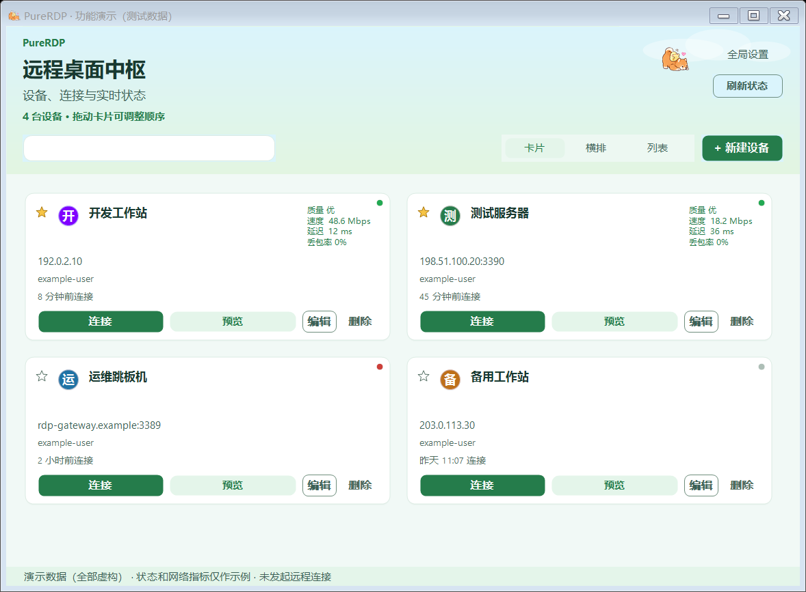
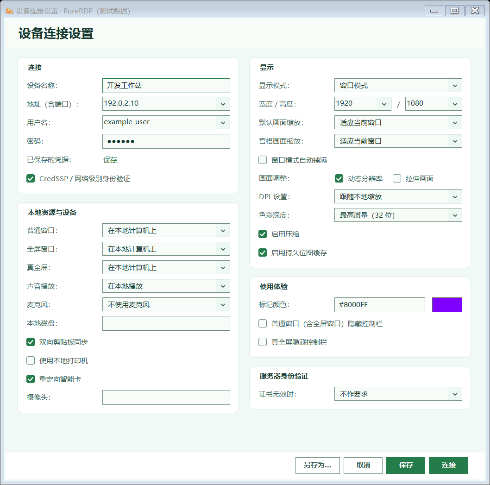
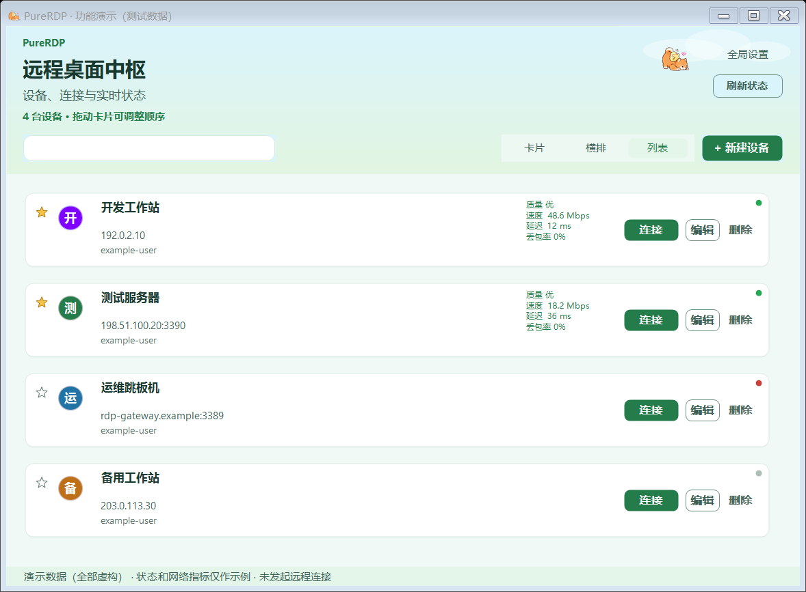
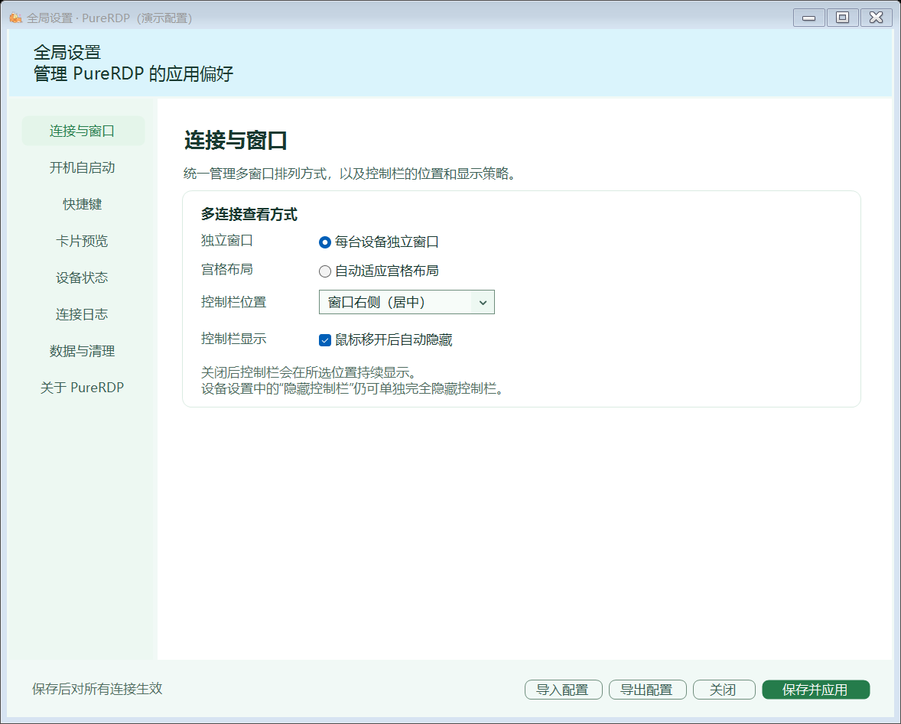
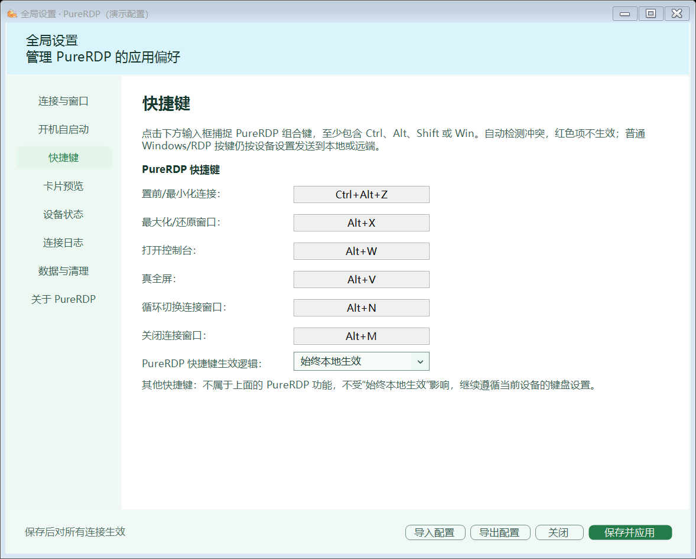
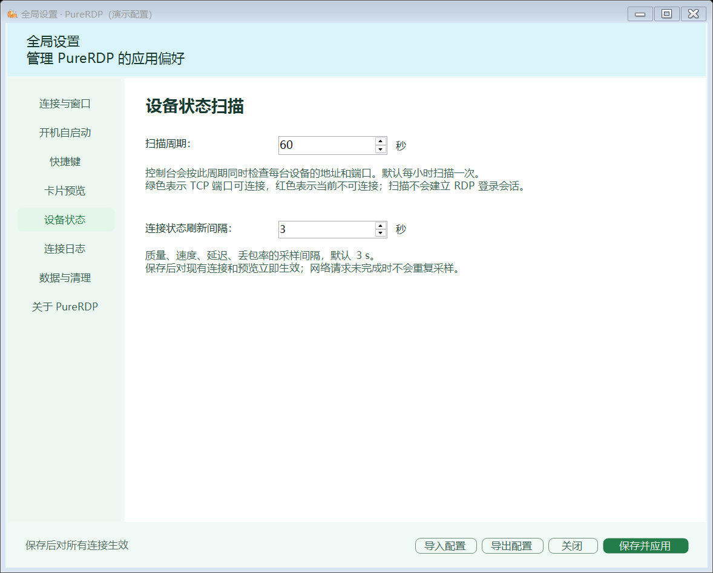

# PureRDP 中文使用说明

PureRDP 将常用远程桌面集中在一个中文工作台中，提供设备库、多窗口管理、只读预览、连接状态和统一设置。项目定位、主要功能及完整界面预览见 [项目首页](README.md)。

本页侧重如何使用和维护应用；[更新日志](CHANGELOG.md) 只保留最近一次更新，更早记录见 [历史更新日志](CHANGELOG_HISTORY.md)。

## 快速开始

外部普通 `.rdp` 与运维助手连接默认先使用 PureRDP，首次连接失败再切换原生；普通未知或空字段不会提前分流。不能等价实现的安全模式等仍保留原生语义；也可在“.rdp 代理”中显式开启“外部连接始终使用原生 MSTSC”。支持范围、设置作用与验收边界见 [RDP 兼容说明](docs/RDP-compatibility.md)。

运行前准备 Windows x64、.NET 10 Desktop Runtime x64，以及可访问的远程桌面目标。默认交付不带运行时的单文件程序，无需安装 MSI。

1. 运行 `PureRDP.exe`，点击“新建设备”。
2. 输入地址和端口，或从下拉框选择当前用户原生 RDP 的历史地址。
3. 确认用户名。已有 Windows 保存凭据时可复用；只有用户名提示而未保存密码时，仍需输入密码。
4. 保存后，在控制台点击“连接”。使用“编辑”调整该设备，使用“全局设置”调整应用偏好。

更新程序前，先从系统托盘退出旧程序。免安装不等于无运行数据，清理方式见“设置保存与自启动”和应用内“数据与清理”页。

## 功能截图

以下均为实际界面的虚构测试数据，不含真实设备凭据；网络状态、指标与连接时间仅用于演示。



<details>
<summary>查看设备设置与其他功能页面</summary>











</details>

## 设备库前端

首页采用三种设备视图：卡片、横排和列表。支持实时搜索、单击卡片直接连接、编辑、删除、拖动排序、键盘 Enter/Space 连接，以及自动保存视图和顺序。主界面使用不透明的高对比按钮；半透明流动玻璃控制条仅在 RDP 连接窗口启用，避免首页按钮与背景混淆。

点击设备左上角小星星，星星填充黄色并将设备置顶；再次点击取消置顶，回到普通设备排序。多台置顶时最近置顶的设备排在前面，也可在置顶组内拖动调整顺序；普通设备不能拖入置顶组。三种视图、搜索结果和重启后都保留置顶状态。星星按钮获得键盘焦点后，Enter/Space 用于切换置顶，不触发连接。

设备状态圆点表示 TCP 地址和端口的可达性，不代表账号已通过认证或 RDP 登录成功。连接质量、延迟和丢包属于采样结果，实际可用性仍需结合远程操作与服务端状态判断。

## 快捷键默认值

| 功能 | 默认快捷键 | 再次按下 |
| --- | --- | --- |
| 置前/最小化连接 | Ctrl+Alt+Z | 最小化或原样恢复全部连接窗口；没有连接窗口时不处理。后台预览不计入连接窗口 |
| 最大化/还原窗口 | Alt+X | 切换窗口状态 |
| 打开控制台 | Alt+W | 返回原连接；无连接时显示/隐藏控制台 |
| 真全屏 | Alt+V | 切换真全屏状态 |
| 循环切换连接窗口 | Alt+N | 切换下一个连接 |
| 关闭连接窗口 | Alt+M | 关闭当前连接 |

可在“全局设置 → 快捷键”捕捉新组合，Esc 或 Backspace 清空。系统注册检测不能识别所有其他软件自定义键盘钩子的冲突。自动检测及编译检查不等同于全部远程桌面环境的实测。

快捷键页中的“同步连接窗口”会让 PureRDP 控制快捷键跟随当前连接的键盘模式；“始终本地生效”会优先在本机处理这些 PureRDP 控制快捷键。普通 Windows/RDP 按键不属于 PureRDP 快捷键，始终遵循当前设备的键盘模式。

## 设置保存与自启动

- 设备连接文件通常位于 `%APPDATA%\PureRDP\Recent\`，格式为 `.rdp`。无法写入时依次尝试本地应用数据目录、程序目录下的数据目录和临时目录。
- 全局设置位于 `%APPDATA%\PureRDP\global-settings.json`；设备列表布局通常位于 `%APPDATA%\PureRDP\connection-library.json`。
- 密码由 Windows 凭据管理器保存，不写入连接配置明文。
- 移动连接窗口：仅通过展开控制栏后的九点区域拖动，不再支持 `Ctrl+Alt+左键` 移动。最大化窗口拖动后还原；宫格中只移动当前连接，不影响其他窗口，新增/关闭连接等原有自动平铺动作仍可重新排列。真全屏禁用移动；Esc 可取消正在进行的移动，双击拖动区不切换窗口状态。控制栏空白处点击不执行操作。
- 调整窗口大小：仅保留左下、右下两个约 `5×5` 的低可见度半透明缩放点，长宽可分别自由调整，不锁定比例。拖动后按设备记住窗口大小和位置，正常关闭后保存在窗口状态文件中；下次打开窗口模式时，勾选“窗口模式自动铺满”会优先最大化至工作区并保留本机任务栏，未勾选则恢复手动尺寸，而不是反复套用初始分辨率。手动还原仍可使用原尺寸；自动宫格布局和真全屏不会覆盖该手动记录，显示器移除时会将窗口移回可见区域。
- 未保存密码、停留在 Windows 登录画面时，窗口变化也会先做本地画面适配；登录成功后再更新远端分辨率，不因拖动重连或清除正在输入的密码。旧客户端不支持放大接口时，采用原生尺寸适配作为兼容回退。
- 编辑设备输入密码后点击“保存”，会保存 PureRDP 专属凭据，后续连接重复读取；旧版未持久保存的密码需重新输入保存一次。凭据与账号、完整地址（含端口）匹配，不跨设备复用；远端强制验证策略仍以服务器为准。
- 开机自启动针对当前 Windows 用户登录，通过 `HKEY_CURRENT_USER\Software\Microsoft\Windows\CurrentVersion\Run` 下的 `PureRDP` 项登记。
- 需要登录后只驻留托盘时，同时勾选“静默启动”。启动项直接运行 `PureRDP.exe --silent`，不经过命令行脚本；程序会在首次显示前拦截主窗口，重复静默启动也不会唤窗。之后仍可通过托盘或正常双击程序打开控制台。
- 移动 EXE 后，在新位置运行程序，再点击“修复路径”。取消自启动并保存会删除此启动项。
- 自启动路径属于本机配置，不随全局 JSON 导入或导出。修改设备设置后点击保存，后续连接和重启将从保存的文件读取。

## 已汉化

- 连接和设置界面、显示模式、DPI、色彩深度、身份验证选项。
- 声音、麦克风、打印机、剪贴板、磁盘和智能卡设置。
- 系统菜单、连接状态、设置校验、文件导出和命令行帮助。
- 新增摄像头输入框：填 `*` 使用全部摄像头，留空关闭，也可保留指定设备路径。

微软控件自身的登录、证书及错误对话框由 Windows 语言资源决定，内部错误码保留原值，便于排查。

## 外设使用

1. 填写计算机地址和用户名。
2. 在“本地资源与设备”中开启“双向剪贴板同步”和“使用本地打印机”。
3. 麦克风选择“使用本地麦克风”；摄像头填 `*`。
4. 如需磁盘，填 `C;E` 等盘符或 `*`。GUI 会保留你的选择。
5. 连接后在远端目标应用中验证摄像头、录音和实际打印。服务端策略、设备驱动和应用兼容性仍决定最终可用性。

“动态分辨率”会改变远端实际桌面尺寸；“拉伸画面”仅缩放图像。两者互斥。当前没有新增任意 FPS 滑块。

## 显示清晰度与推荐配置

未配置时默认使用窗口模式，开启“窗口模式自动铺满”和“动态分辨率”，关闭“拉伸画面”，默认画面缩放为“适应当前窗口”，色彩深度为 32 位，DPI 跟随本地，并开启压缩与持久位图缓存。连接栏默认在顶部。用户已经保存的设置保持原值；要与传统 100% 显示做同条件对照时，可手动选择 100% DPI。

清晰度主要取决于远端实际桌面像素与当前客户区是否匹配。动态模式会在首次连接时按实际客户区申请桌面，尺寸匹配时关闭 SmartSizing；设置页的宽高仍用于初始化普通窗口大小，不表示动态连接永远固定为该尺寸。窗口模式保留任务栏和边框，实际客户区与整块显示器的分辨率不同；需要占满工作区时开启自动铺满。

“外部 .rdp / MSTSC 连接使用通用连接设置”在未配置时默认开启；此前已保存为关闭的选择保持不变。可在“.rdp 代理”页检查开关，保存通用设置编辑器后在全局设置中“保存并应用”，再重新发起连接。关闭该选项时模板不会应用；原生兼容窗口也不应用此模板。

远端拒绝尺寸变化时，为显示完整桌面仍可能进行等比缩放；本地缩放不能增加远端已经渲染的细节。请在同一电脑、相同窗口大小下对照，不能仅比较截图显示尺寸。

## 从源码生成 EXE

GitHub Actions 使用 .NET 10，构建与发布均开启分析器。WinForms 设计器属性序列化检查（WFO1000）和编译器问题会阻断构建；第三方 IDISP 资源所有权提示仍输出为警告，需人工审查。CI 使用 runner 临时目录缓存 NuGet 包，运行 `Build/scripts/purerdp.test.ps1` 执行 9 组离线回归，报告位于 `outputs/ci-tests/TestResults/`。发布工作流从 Release 标签的源码构建，只上传不带运行时的 EXE 和说明文件。

需要 Windows、.NET 10 SDK 和 PowerShell。首次构建先恢复依赖，再编译应用项目：

```powershell
. ./Build/scripts/_nuget-cache.ps1
dotnet restore PureRDP/PureRDP.csproj -r win-x64
dotnet build PureRDP/PureRDP.csproj -c Release
./Build/scripts/purerdp.publish-portable-zh.ps1
```

发布脚本可通过 `-Dotnet` 指定本地 SDK 的 dotnet.exe，默认优先使用 `D:\Agant\toolchain\dotnet\dotnet.exe`。构建与发布脚本统一使用 `D:\Agant\toolchain\nuget\packages` 存放 NuGet 缓存，不再在项目内创建 `.nuget`。直接运行 dotnet 命令时，先执行 `. ./Build/scripts/_nuget-cache.ps1`。发布脚本会先恢复依赖并刷新缓存路径，再以 `--no-restore` 发布。默认只生成 Windows x64 不带运行时的单文件程序，不构建安装器，不生成压缩包或带运行时版本。

- 运行版：`D:\Agant\Github_Releases\PureRDP\`。
- 源码：`D:\Agant\Github_Source\PureRDP\`，内附 `outputs/<当前版本>-independent-preview/PureRDP.exe`。
- `-ReleaseDirectory` 和 `-SourceDirectory` 可修改输出父目录，其下统一使用 `PureRDP` 名称。替换前校验文件哈希，历史输出移到项目内可恢复备份；被运行中的程序占用时不会强行关闭进程。

也可仅生成不带运行时的可执行文件：

```powershell
. ./Build/scripts/_version.ps1
$versionFile = './Build/targets/version.props'
$version = Get-PureRdpPackageVersion -VersionFile $versionFile
$fileVersion = ([xml](Get-Content -LiteralPath $versionFile -Raw)).Project.PropertyGroup.FileVersion
dotnet publish PureRDP/PureRDP.csproj -c Release -r win-x64 --self-contained false -p:PublishSingleFile=true -p:PublishTrimmed=false "-p:Version=$version" "-p:FileVersion=$fileVersion" -o "outputs/$version-independent-preview"
```

### 每日版本规则

当前版本为 `2.0.5`，Windows 文件版本为 `2.0.5.0`，统一读取 `Build/targets/version.props`。默认本地正式打包按北京时间（UTC+8）的自然日判断，同日沿用同号；第三段满 9 后向第二段进位，例如 `2.0.9 → 2.1.0`，主版本不变。隔几天未打包，下一次也只进一次，不补涨，不安排每日定时编译。日常构建和测试不分配版本；明确指定的版本及 Release 标签按指定值执行，不应在日常交付命令中长期固定旧版本。

`Build/targets/version.props` 同时记录当前版本、Windows 文件版本和 `LastPackageVersionDate`，它是需随源码保留的版本状态，不是可清理缓存。正式打包开始时原子分配版本，并用跨进程锁避免同一天重复递增；Windows 文件版本与程序集保持对应的四段格式。普通 `dotnet build`、构建/测试脚本只读取当前版本，不递增。

默认打包请使用 `purerdp.publish-portable-zh.ps1`，无需传 `-Version`。确需固定版本时可显式传入 `-Version`，此时严格使用指定版本，不改本地每日状态；GitHub Release 构建同样严格使用标签版本。直接调用底层 `dotnet publish` 不会自动执行日增规则，需先按上例分配版本。修改规则本身或仅更新文档不会立即产生新版本。

离线 UI 回归检查（统一入口自动构建，并使用不切换的隔离桌面，避免测试窗口在前台闪现）：

```powershell
./Build/scripts/purerdp.test.ps1 -Suite UiDesign
```

完整回归运行 `./Build/scripts/purerdp.test.ps1`；构建与测试入口也支持 `-Dotnet` 指定 SDK。隔离桌面创建失败会停止，不回退到前台执行。单项测试、输出及限制见 [回归说明](Build/tests/README.md)。

编译、渲染和离线回归不等于真实 RDP 会话、高 DPI、多显示器或长时间运行验收。

## 感谢与支持

感谢您使用 PureRDP！欢迎通过 Star、分享和反馈支持项目，也可以自愿赞助，帮助分担 AI 辅助开发的 Token 费用及测试维护成本。赞助不影响任何功能的使用，收款码见 [项目介绍中的感谢与支持](README.md#感谢与支持)。

## 堡垒机会话文件与 .rdp 代理

控制台点击“打开 .rdp”可直接选择文件建立连接。需要右键或双击打开时，进入“全局设置 → .rdp 代理”，点击“设置默认应用”，再在 Windows 中将 `.rdp` 选为 PureRDP。注册仅作用于当前用户，程序移动位置后需要重新注册。

网页运维助手直接启动 `mstsc.exe` 时，文件默认应用不会参与。此时可在同一设置页点击“开启启动代理”，通过 Windows 管理员授权后由 PureRDP 接收启动请求。代理作用于本机所有用户，不替换 mstsc.exe；支持会话文件及常用 `/v`、`/w`、`/h`、`/f`、`/multimon`、`/admin`、`/prompt` 参数，其他参数会明确提示，不静默忽略。H5、私有客户端与并非启动 mstsc.exe 的助手不在此入口范围内。

代理状态在按钮上方直接显示“已开启/未开启”；开启后仍可点击“重新配置”更新程序路径。通用设置的勾选修改会显示“待保存”，点击底部“保存并应用”后才显示实际启用状态。

多品牌助手共用启动格式解析：兼容重复程序路径、带引号的完整命令行、`file:///` 文件地址；没有 `.rdp` 后缀的临时文件会检查内容。常见地址和尺寸参数接受冒号、等号或分隔值写法，`/fullscreen` 与 `/f` 等价。涉及网关、特殊认证或其他尚未实现的选项会明确提示，不通过忽略参数改变原有安全含义；具体品牌的授权与单点登录仍需使用有效会话实测。

“关闭并恢复”还原代理启用前的启动值；已被其他工具修改时不会覆盖。移动或删除 PureRDP.exe 前请先关闭代理。恢复文件默认应用时，点击“恢复原生打开”，再在 Windows 中把 `.rdp` 选为“远程桌面连接”。Windows 的默认应用选择仍需用户完成，不直接修改 UserChoice。

可开启“外部 .rdp / MSTSC 连接使用通用连接设置”，并编辑与设备连接一致的显示、资源、缩放、键盘及身份验证选项，点击全局设置底部“保存并应用”后用于新连接。模板不包含地址、账号、密码与票据，不修改设备库；开启后覆盖外部文件的同类通用选项。

设备库中每个地址分别保存分辨率等配置。外部连接使用通用模板后，登录成功不会自动写回同地址的已保存设备；只有在设备编辑页明确保存才更新该设备的配置。宫格布局、自动铺满与动态分辨率可能改变实际窗口/远端画布大小，这与修改已保存配置是不同的行为。

“连接与窗口 → 连接窗口圆角”默认开启。普通连接窗口使用 16 个物理像素的圆角，左右底角的独立拖动控件保留；真全屏显示完整矩形画面。

可通过 `PureRDP.exe "会话文件.rdp"` 打开助手生成的标准 RDP 文件。程序会读取 `loadbalanceinfo` 并在连接前传给原生控件；该参数可能包含临时会话票据，仅在当前配置内存中使用，不导出到普通设备配置或 JSON，也不自动将该会话存为可复用设备。原始会话文件保持不变。

路由参数按 ActiveX 的二进制字符串要求编码，并使用本机模拟服务器核对实际连接首包。连接失败后的重试显示在当前连接窗口内，使用蓝色水晶加载动画，不另弹窗口；倒计时从 2 秒起逐次翻倍，最多重试十次。“取消并关闭”立即关闭当前连接，十次均失败也会自动关闭。

测试时请从堡垒机正常发起新的授权连接，再使用本次生成的文件；旧文件中的票据可能已使用或过期。此入口不等于接管助手的私有协议，也不保证所有厂商的单点登录均兼容。

助手文件中若带有 `password 51:b:`，PureRDP 会在连接前尝试使用 Windows DPAPI 读取其加密密码。请在生成文件的电脑和同一 Windows 用户下运行；不要将临时文件复制到另一台电脑后期待其密码仍可使用。解密后的密码仅用于当前连接，不回显、不写入日志、设备导出或通用配置，读取失败时也不会改用其他已保存凭据。只有路由票据的文件仍走原有票据流程。

带票据或加密密码的助手文件使用显示兼容处理：动态模式首次按实际客户区申请桌面；明确关闭动态分辨率时保留文件中的宽高。后续不向旧会话反复请求尺寸，必要时在本地等比适配；远端与客户区匹配时采用 1:1 显示。显式勾选“外部连接使用通用连接设置”后，改用通用配置。

## 项目来源与许可

基于 [fschick/FluentRDP](https://github.com/fschick/FluentRDP) 的中文衍生版本，保留微软原生 RDP ActiveX 核心。源代码沿用上游 GPL-3.0 许可证，原作者及许可见 LICENSE。这不是上游官方中文发行版。

